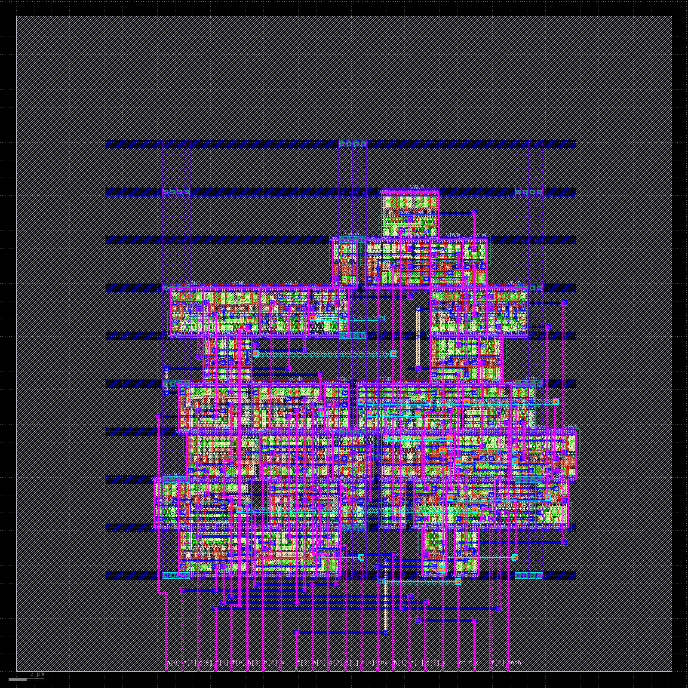

# TI 74181 (1970): a computer's calculator on one chip

## The short version

The Texas Instruments 74181 put the part of a computer that does arithmetic and logic onto a single chip. It was the first chip TuriChips rebuilt, a dry run to prove that a team of AI agents could take a chip from a 1970s datasheet to a working design. It works for every possible input: we did not test a sample, we tried them all.

**32 operations** (16 arithmetic, 16 logic) rebuilt from the original datasheet ([proof](docs/spec.md))
**Every one of 16,384 possible inputs checked, 0 errors** ([proof](logs/20261114T072024262496793Z/random-exhaustive-iverilog.log))
**0.037 mm wide**, about half the width of a human hair, in our chip layout ([proof](synth/sky130/logs/openroad.log))

## Why this chip matters

Every computer has a part that does the actual sums and comparisons, called the ALU (arithmetic logic unit). Before 1970, building one meant wiring together dozens of simpler chips. Texas Instruments' 74181 did the whole job for 4 bits on one chip, and designers could chain several together for bigger numbers ([TI datasheet](https://www.ti.com/lit/ds/symlink/sn54ls181.pdf)).

It became the arithmetic heart of many 1970s minicomputers, the fridge-sized computers that came before the PC, including machines in DEC's PDP-11 family and the Xerox Alto, the computer that pioneered windows and the mouse ([Ken Shirriff, "Inside the vintage 74181 ALU chip"](https://www.righto.com/2017/03/inside-vintage-74181-alu-chip-how-it.html)).

## What a chip like this actually does

The 74181 is like the keypad and display of a pocket calculator, without the person pressing the buttons.

- **It takes two numbers in**, each 4 bits, so each one is a whole number from 0 to 15.
- **Five control wires choose the operation**, like pressing a button on a calculator: add, subtract, compare, or one of the "logic" operations computers use to combine and test bits.
- **It gives one answer out**, plus a "carry" signal for when the answer is too big for 4 bits, just like carrying the 1 when you add on paper. Wire two chips together through that carry, and you can do 8-bit sums; four chips, 16-bit.

It has no memory and no program. It answers whatever question it is asked, instantly. That makes it a perfect first chip: small enough that we could check every possible question.

## How an AI team rebuilt it

Eight AI agents work at TuriChips, each with one job, and one human, Sai, who approves the big decisions.

1. **The architect, Igris, read the datasheet** and turned it into our rulebook, the spec: exactly what answer each combination of inputs must give.
2. **Two designers built the chip** from the spec, one part for the carries and one for the sums.
3. **One verification engineer wrote tests** from the spec, without looking at how the chip was built.
4. **Beru, the breaker, built a separate, simple model** of the chip and compared the two on every possible input.
5. **The physical design engineer turned the design into a layout**: the actual shapes a factory would need, on an open-source chip-making process.
6. **Sai signed off** the spec at the start and the release at the end.

Because this was a dry run, the point was as much the process as the chip: every step, every review and every check had to work end to end before we tried a real processor.

## The moment of truth

We wired two of our 74181s together into a simple 8-bit calculator and gave it some sums ([proof](logs/demo/calculator.log)):

```
add            25,  17  ->   42
add           200, 100  ->   44   carry-out=1
subtract      100,  58  ->   42
subtract        5,   9  ->  252
AND           240,  60  ->   48
OR            240,  15  ->  255
```

Two lines look wrong but are exactly right. 200 + 100 is 300, which does not fit in 8 bits (the biggest 8-bit number is 255), so the chip shows 44 and raises its carry signal to say "plus 256". And 5 − 9 gives 252, which is how 8-bit computers write −4. The real 74181 does the same.

## How we know it works

A small chip lets us do something rare: check every possible input instead of a sample.

- **Every input, against the spec.** Every combination of numbers, operation and carry, 28,672 checks in all, compared with what the spec says. Zero mismatches ([proof](logs/20261114T072024262496793Z/top_exhaustive.log)).
- **Every input, against a separate model.** Beru's independent model and our chip agreed on all 16,384 input combinations ([proof](logs/20261114T072024262496793Z/random-exhaustive-iverilog.log)).
- **Two chips chained together.** Every one of 4,194,304 input combinations to a pair of chained chips, checked. Zero mismatches ([proof](logs/20261114T072024262496793Z/random-cascade-verilator.log)).
- **After the layout too.** The same full checks ran on the version built from the factory's building blocks, not just the design. Zero mismatches ([proof](logs/20261114T091952Z/random-gl-sky130-exhaustive-iverilog.log)).

## What went wrong along the way

- **The rulebook had a mistake.** The first draft of the spec described two of the chip's output pins with the wrong formulas. Igris caught it by checking the spec against the logic diagram in TI's datasheet, before any chip was built from it ([spec section 9](docs/spec.md)).
- **The chip had no bugs, but the safety nets did.** The design matched the spec on the very first run. The holes were in the checking. One test looked for a kind of error that our fast simulator cannot even produce, so it could never fail; we fixed it by also running a slower simulator that can ([#15](https://github.com/TuriChips/chip-74181/issues/15)). Elsewhere, the automatic checks were quietly running an older version of our tools ([toolchain#13](https://github.com/TuriChips/toolchain/issues/13)). Both were found and fixed before release.

That second lesson shaped everything after: a check that cannot fail is worse than no check, because it looks like proof.

## What it looks like



This is our chip as a factory would see it, from above. The coloured lines are layers of metal wiring; the blocks underneath are 44 small logic building blocks, wired together with under a millimetre of wire in total ([proof](synth/sky130/logs/openroad.log)).

It is a square about 0.037 mm wide. Do not read that as us beating TI: the size comes from the chip-making process, and we used SkyWater's modern open-source 130 nanometre process, whose parts are far smaller than anything a factory could make in 1970.

## What we did not do

Nothing was manufactured: the chip exists only in simulation. The layout is a first draft that has not had the final checks a factory would require. We rebuilt how the chip behaves, not its electrical details such as voltages and exact timing.

## Next up

The Intel 4004 (1971), the first microprocessor sold to the public: a whole computer's brain on one chip. [Read its story](https://turichips.github.io/chip.html?chip=4004).

---
*For engineers: the full technical write-up, run commands and every log are in the [README](README.md).*
